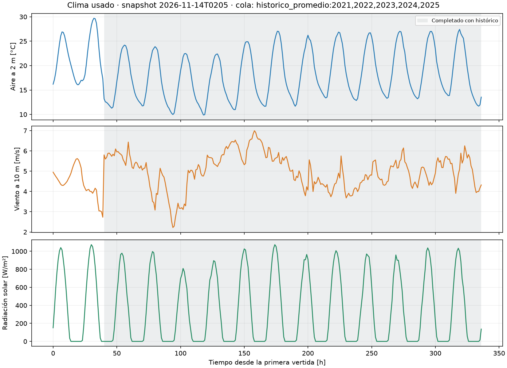
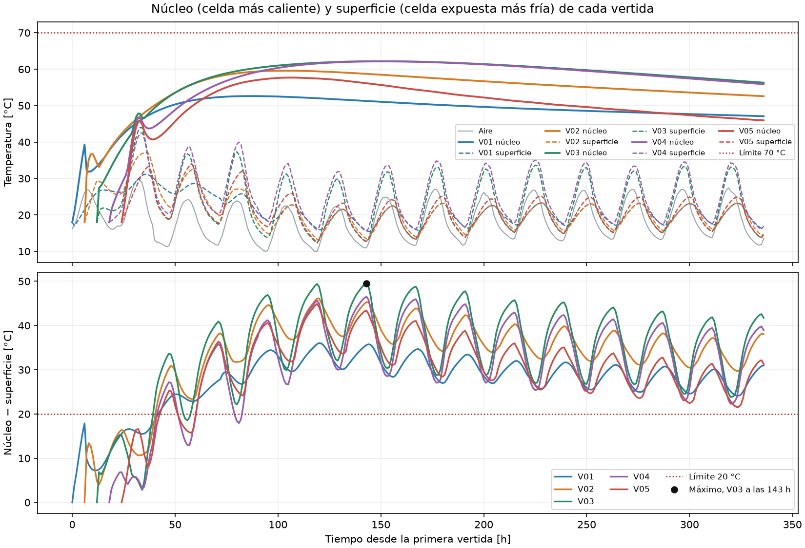
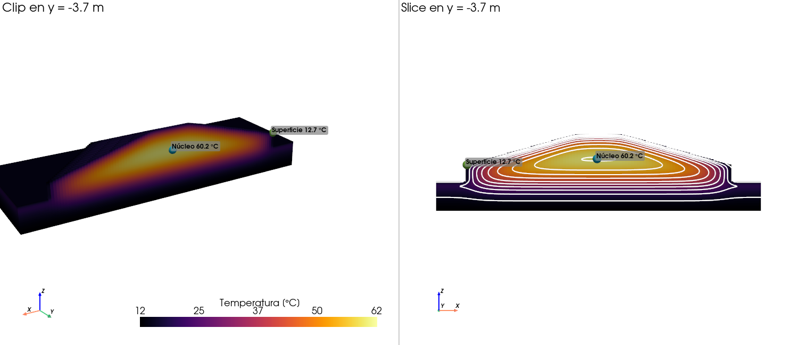
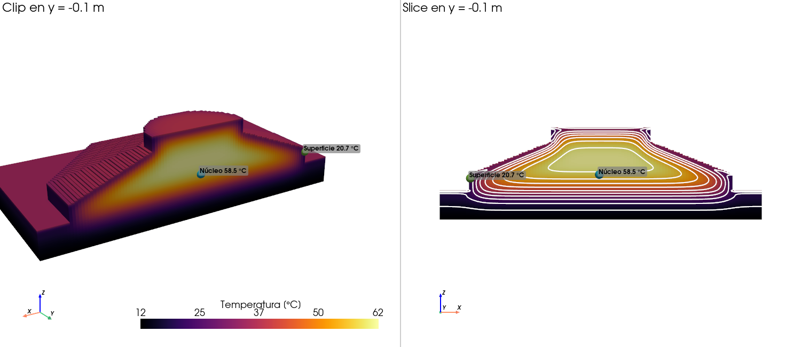

# E12 — Simulación determinista de 14 días

**Repositorio:** https://github.com/aespinoza6-svg/P2-Grupo7

**Commit evaluado:** el que se declara en Canvas, que contiene este informe. Los resultados se generaron con el código del commit [`c2787e8`](https://github.com/aespinoza6-svg/P2-Grupo7/commit/c2787e848c6a49ece2aa3b9d830b53000cc5a671), registrado en `resultados/e12/caso_14dias/resumen.json`. Después de ese commit solo se agregaron resultados y este informe.

## 1. Integración física

Simulamos 336 h desde la primera vertida con un solver de volúmenes finitos explícito:

| Componente | Cómo entra |
|---|---|
| Geometría | IFC voxelizado: dx = dy = 0,20 m, dz = 0,05 m. Son 801 972 celdas activas con el suelo |
| Vertidas | Se activan a su hora del IFC, con su temperatura de colocación |
| Hidratación | **Una curva**, M1: θ(t) = 45·(1 − e^(−t/30 h)) °C, de la guía del curso (sección 24), sin dependencia de la temperatura |
| Suelo | Bloque de 2 m de espesor con 2 m de margen: k = 1,5 W/m·K, ρ = 1900 kg/m³, cp = 1000 J/kg·K, 12 °C |
| Moldaje y aislación | Moldaje lateral de R = 0,14 m²K/W, retirado a las 72 h de cada vertida. Sin aislación |
| Clima | Aire, viento y sol hora a hora (sección 2) |
| Visualización | Curvas, cortes y VTK 3D abiertos con PyVista |

Hormigón: k = 2,0 W/m·K, ρ = 2400 kg/m³, cp = 900 J/kg·K. Δt = 600 s, bajo el límite C/ΣG, en 2016 pasos. El residuo del balance de energía es 1,3·10⁻¹⁵.

## 2. Clima y trazabilidad

| Campo | Valor |
|---|---|
| Fuente | Open-Meteo: `best_match` para el pronóstico y ERA5 para el histórico |
| Snapshot | `data/weather/2026-11-14T0205/` |
| Descarga | 2026-11-14T02:05:42Z, o sea el 13-nov a las 23:05 en Chile |
| Coordenadas | −37,6921; −72,624 |
| SHA-256 de `forecast.json` | `d692bc11…a4c9b` |
| Horizonte | 27-nov 08:00 → 11-dic 08:00 (−03:00); la fecha de inicio es provisional |

**Horizonte no cubierto.** El pronóstico llega hasta el 28-nov a las 23:00 y cubre las primeras **40 h**. Las otras **297 h** se completan con el **promedio hora a hora de ERA5** de las mismas fechas en 2021–2025. Desde ahí es un escenario climático típico, no un pronóstico. `clima.png` sombrea esas horas. Existe una cola conservadora, `historico_frio`, para la etapa probabilística.



## 3. Condiciones de borde

| Superficie | Tipo | Parámetros |
|---|---|---|
| Caras superiores expuestas (z+) | Robin con clima y sol | $q=(T_{sa}-T)/(\Delta z/2k+1/h)$, con $T_{sa}=T_{aire}+\alpha G/h$; α = 0,65 |
| Caras laterales (x±, y±) | Robin con clima y moldaje | R = 0,14 hasta las 72 h de cada vertida; después R = 0 |
| Suelo alrededor | Robin con clima y sol | R = 0 |
| Entre vertidas y hormigón–suelo | Conducción | $G=A/(\Delta/2k_i+\Delta/2k_j)$ |
| Fondo del suelo (z = −2 m) | Dirichlet | 12 °C |
| Costados del suelo | Neumann | q = 0 |

En todas las caras con clima, $h=5{,}7+3{,}8V+4\varepsilon\sigma T^3$, con ε = 0,9. En este horizonte, h va de 19 a 37 W/m²K.

## 4. Plan de vertidas actual

Sale del IFC, con el pset `UANDES_HormigonMasivo`. Todas las vertidas se colocan a 18 °C y se desmoldan a las 72 h.

| Vertida | Elemento | z [m] | Volumen [m³] | Inicio |
|---|---|---|---|---|
| V01 | Losa de borde | 0,00–0,55 | 147,6 | 0 h, 27-nov 08:00 |
| V02 | Losa de borde | 0,55–1,10 | 147,6 | 6 h |
| V03 | Transición | 1,10–2,20 | 214,2 | 12 h |
| V04 | Transición | 2,20–3,30 | 88,9 | 18 h |
| V05 | Pedestal Ø7 m | 3,30–4,30 | 38,4 | 24 h |

## 5. Resultados

| Métrica | Valor | Criterio | ¿Cumple? |
|---|---|---|---|
| **T máx** | **62,19 °C** | ≤ 70 °C | ✅ con 7,8 °C de margen |
| **ΔT máx** | **49,52 °C** | ≤ 20 °C | ❌, unas 2,5 veces el límite |
| Horas con ΔT > 20 °C | 297 de 337, desde las 40 h | | |

**Cuándo y dónde.** Las coordenadas están en m; el origen está en el centro de la planta, en la base.

| Máximo | Tiempo | Ubicación |
|---|---|---|
| T máx | 150 h, el 3-dic a las 14:00 | Centro de V03: (−0,1; −0,1; 2,08) |
| ΔT máx | 143 h, el 3-dic a las 07:00 | V03. Núcleo en (−0,1; −0,1; 2,03) a 62,17 °C. Superficie en su cara lateral desmoldada, en (−8,9; −3,7; 1,13), a 12,65 °C |

ΔT se calcula dentro de cada vertida: la celda más caliente menos la celda expuesta más fría. El centro de una celda lateral está a 10 cm de la cara y no a los 25 mm del criterio. A 25 mm el hormigón está todavía más frío, así que **el incumplimiento no depende de esta aproximación**.

### Curvas núcleo y superficie



- **Núcleos:** en V03 y V04 llegan a unos 62 °C y pierden solo 6 °C en los 8 días siguientes. V01 llega a unos 52 °C, porque el suelo le quita calor.
- **Superficies:** siguen el ciclo diario del aire. Las caras superiores, con sol, llegan hasta unos 40 °C.
- **ΔT:** pasa de 20 °C a las 40 h y salta con los desmoldes, a las 72–84 h. Desde ahí oscila cada día, con el peor valor al amanecer.

## 6. Visualización 3D

Estos campos se exportaron con `--vtk-maximos` y se abrieron con PyVista. A la izquierda hay un clip y a la derecha un slice con isotermas cada 5 °C.

**ΔT máx, a las 143 h, en el plano y = −3,7 m.** La cara lateral de V03 está a 12,7 °C, y el interior, a 60 °C, a pocos metros. Las isotermas se aprietan contra el borde.



**T máx, a las 150 h, en el plano y = −0,1 m.** El núcleo amarillo de V03 y V04 está a unos 62 °C. Las tapas están tibias por el sol de las 14:00. Los marcadores muestran el par núcleo–superficie que elige el script en ese plano.



## 7. Conclusión

**¿El plan cumple determinísticamente? No.**
- La T máx cumple: 62,2 °C contra 70 °C.
- El diferencial no cumple: 49,5 °C contra 20 °C, y lo supera durante 297 de 337 h.

**¿Qué mecanismo controla el resultado?** La pérdida de calor de la superficie frente a un núcleo casi adiabático.

1. **El núcleo no alcanza a enfriarse.** El tiempo de difusión es t ≈ L²/α = 2²/9,26·10⁻⁷ s ≈ 50 días, mucho más que 14. El núcleo llega al 99 % del tope adiabático, 18 + 45·(1 − e^(−138/30)) = 62,5 °C. **La T máx la fija la hidratación**, no el clima.
2. **La superficie sigue al aire.** Con h de 19 a 37 W/m²K, noches de unos 10 °C y desmolde a las 72 h, las caras laterales quedan unos 50 °C más frías que el núcleo. De los 61,8 GJ de la hidratación, 21,8 GJ salen por los bordes.

**El diferencial controla el plan.** Las medidas útiles actúan sobre la superficie: aislación, moldaje por más tiempo y no desmoldar antes de noches frías. Aislar puede subir la T máx, así que hay que revisar ambos criterios en E13–E15.

**Limitaciones:**
- Hidratación pedagógica.
- Suelo y moldaje con valores típicos.
- h(V) por una correlación.
- Cielo a la temperatura del aire.
- ΔT por celdas.
- Un solo escenario climático.

## 8. Cómo reproducir

```powershell
python -X utf8 scripts/14_simular_ambiente.py --snapshot 2026-11-14T0205 --vtk-maximos --salida resultados/e12/caso_14dias
python -X utf8 scripts/15_ver_vtk.py resultados/e12/caso_14dias/campo_dTmax_143h.vtk --plano y --pos -3.7 --png resultados/e12/caso_14dias/vista3d_dTmax_143h.png
python -X utf8 scripts/15_ver_vtk.py resultados/e12/caso_14dias/campo_Tmax_150h.vtk --plano y --pos -0.1 --png resultados/e12/caso_14dias/vista3d_Tmax_150h.png
```

La corrida tarda unos 200 s. Si falta la grilla, primero hay que correr `scripts/07_voxelizar_ifc.py`. Los VTK pesan 15 MB cada uno y no se suben al repositorio.

Las salidas, en `resultados/e12/caso_14dias/`, son:
- `resumen.json`, con las métricas, las ubicaciones, el clima y las huellas SHA-256;
- los archivos CSV;
- las figuras.
