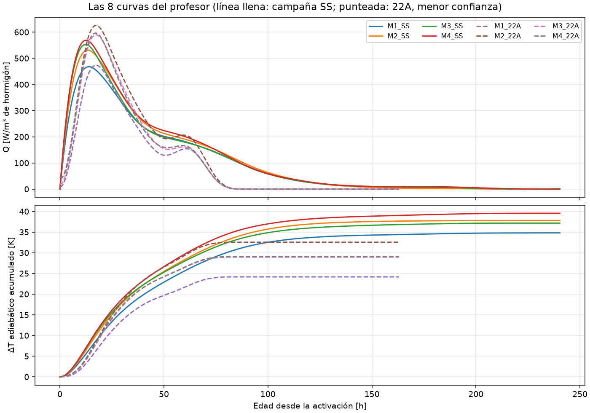
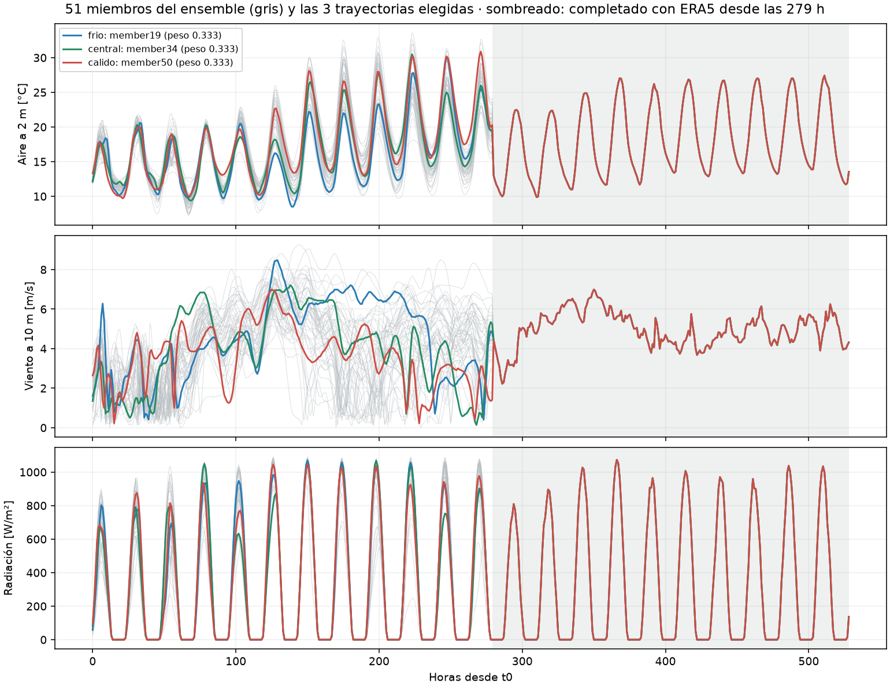
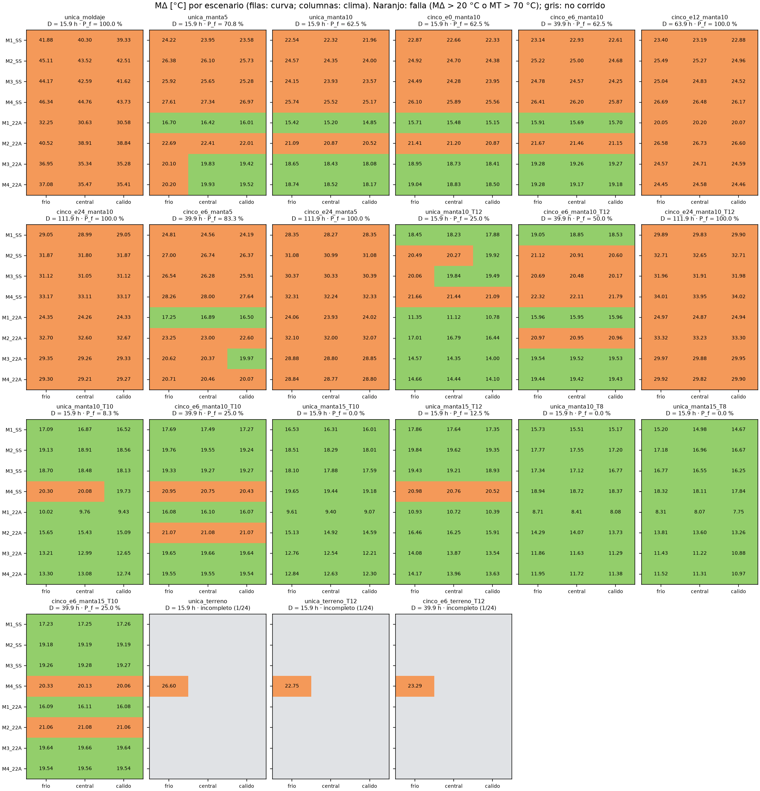
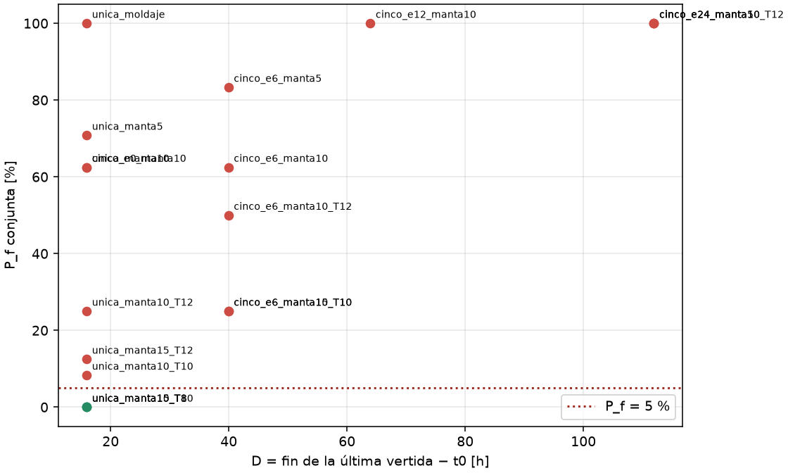

# E13 — Modelo de incertidumbre y plan más rápido

Preparación del taller del miércoles 18-nov, la defensa del jueves 19 y el artículo.

**Repositorio:** https://github.com/aespinoza6-svg/P2-Grupo7

**Commit:** el que se declara en Canvas. `resultados/e13/*/resumen.json` registra el commit del código con que se corrió cada resultado.

## 0. La afirmación que podemos sostener hoy

> **Plan propuesto: `unica_manta15_T5`, la vertida única, D = 15,9 h.** Empieza el jueves 19-nov a las 08:00 y termina a las 23:55, con una bomba de 40 m³/h, hormigón **colocado a 5 °C** y **moldaje + 15 cm de poliestireno** en todas las caras expuestas, sin retirarlo en el horizonte. Es el plan más rápido posible con una bomba.
>
> **Con la malla final (0,2 × 0,2 × 0,05 m) da P_f = 0 %:** cumplen los 24 escenarios, y el peor MΔ es 17,85 °C (M4_SS frío; MT = 44,4 °C). También cumple con todas las sensibilidades de la sección 7: pesos «solo SS» y «22A a la mitad», el miembro más frío del ensemble (18,23 °C) y el suelo a 12 °C (18,49 °C).
>
> **El margen depende de la malla.** En el peor escenario, MΔ sube al afinar la celda lateral: 17,85 °C con 0,2 m, 19,03 con 0,1 m y **19,67 con 0,05 m**. Cumple en todas las mallas corridas, pero los saltos se achican (+1,18 y luego +0,65 °C), y la extrapolación de Richardson da **≈ 20,5 °C** para la malla infinitamente fina, justo sobre el límite (sección 8). Lo declaramos: **el plan cumple con los modelos corridos, pero sin margen en la esquina hormigón–suelo**.
>
> **5 °C es el piso:** ACI 306 no permite colocar más frío en secciones de más de 1,8 m. Lograrlo exige hielo, áridos enfriados o nitrógeno líquido. La manta de 20 cm (ganancia < 0,3 °C) y el faldón aislante sobre el suelo (sección 8.1) se probaron y no ayudan. La palanca que queda para ganar margen son tuberías de enfriamiento, que no se modelaron.

## 1. Cómo reproducir

```powershell
python -X utf8 scripts/16_clima_ensemble.py
python -X utf8 scripts/17_riesgo_planes.py --procesos 15
python -X utf8 scripts/17_riesgo_planes.py --malla final --planes unica_manta15_T5 --climas frio,central,calido
python -X utf8 scripts/17_riesgo_planes.py --malla final --planes unica_manta15_T5 --curvas M4_SS --climas frio_extremo
python -X utf8 scripts/17_riesgo_planes.py --malla final --suelo-T 12,12 --planes unica_manta15_T5 --curvas M4_SS --climas frio,central,calido
python -X utf8 scripts/17_riesgo_planes.py --malla lateral01 --planes unica_manta15_T10,unica_manta15_T5 --curvas M4_SS --climas frio
python -X utf8 scripts/17_riesgo_planes.py --malla lateral005 --planes unica_manta15_T5 --curvas M4_SS --climas frio --procesos 1
python -X utf8 scripts/17_riesgo_planes.py --malla hibrida_z --planes unica_manta15_T10 --curvas M4_SS,M1_SS --climas frio
python -X utf8 scripts/17_riesgo_planes.py --planes unica_manta15_T10_faldon04,unica_manta15_T10_faldon08,unica_manta15_T10_faldon12,unica_manta15_T8_faldon04,unica_manta15_T8_faldon08,unica_manta15_T8_faldon12 --curvas M4_SS --climas frio
pytest -q
```

- **`16`, sin flags:** vuelve a elegir las 3 trayectorias desde el ensemble guardado. Con `--descargar --descargar-suelo` baja datos **nuevos**, que son otro snapshot y otro resultado.
- **`17`, malla de exploración:** corre la familia completa en unos 60–100 min con 15 procesos. Cada corrida guarda su fila apenas termina; si se corta, al volver a correr se saltan las hechas.
- **`17` con `--malla final`:** son 24 corridas de unos 25–70 min cada una, según la carga del computador.
- **Mallas de sensibilidad:** `hibrida_z`, `hibrida_xy`, `lateral08`, `lateral01` y `lateral005`. Cada una cambia solo dx o dz, como se ve en la sección 8. `lateral005` (unos 24 millones de celdas) tarda unas 6,5 h con un proceso y usa unos 2 GB de RAM.
- Toda la configuración del caso está en `config/riesgo_e13.yaml`. Cada valor lleva su origen: [CURSO], [ENSAYO], [ERA5], [TÍPICO] o [DECISIÓN].
- **Para verla en 3D:** abra `visor_laboratorio.html`, vaya a **Vista 3D → «La solución que cumple»** y pulse **▶ Simular la solución**. El navegador repite el peor escenario del plan (M4_SS, trayectoria fría) con los mismos datos del script 17. Con celdas de 0,4 m da MT = 44,42 °C y MΔ por celdas = 16,16 °C, igual que Python. La vista queda en el instante del peor diferencial y marca el núcleo y la esquina fría de la base.

## 2. Datos y su trazabilidad

### 2.1 Las 8 curvas de hidratación

Están en `data/hidratacion/source_terms.txt`: es el archivo original, guardado byte a byte (SHA-256 `182b4a50…7956`).

- **Qué midió el ensayo:** probetas cilíndricas chicas, de r = 3,75 cm y h = 15 cm, en un ensayo **no adiabático**. Se midió la temperatura, y la fuente volumétrica **Q(a) [W/m³ de hormigón]** se reconstruyó invirtiendo el balance de la probeta (volúmenes finitos axisimétricos + Tikhonov, con β = 2,5 W/m²K).
- **Qué entrega el archivo:** la fuente Q ya calculada. No es una temperatura medida, así que **no hay que derivar nada**.
- **Muestreo:** cada 10 min.
- **Propiedades asociadas:** ρ = 2476 kg/m³ y cp = 1023 J/kg·K. Usamos **esas mismas** en el hormigón, porque la curva y sus propiedades viajan juntas. La conductividad, k = 2,0 W/m·K, no viene en el archivo y queda como [TÍPICO].
- **Dosificación:** una sola, con 350,77 kg/m³ de cemento.



| Curva | Pico [W/m³] | Edad del pico | Calor total [MJ/m³] | ΔT adiabático [K] | Fin del registro |
|---|---|---|---|---|---|
| M1_SS | 468 | 13,8 h | 88,2 | 34,8 | 240 h |
| M2_SS | 531 | 13,3 h | 95,7 | 37,8 | 240 h |
| M3_SS | 553 | 12,3 h | 94,2 | 37,2 | 240 h |
| M4_SS | 569 | 12,5 h | 100,2 | 39,6 | 240 h |
| M1_22A | 473 | 17,3 h | 61,2 | 24,2 | 163 h |
| M2_22A | 625 | 17,3 h | 82,5 | 32,6 | 163 h |
| M3_22A | 590 | 17,3 h | 73,3 | 28,9 | 163 h |
| M4_22A | 596 | 17,2 h | 73,6 | 29,1 | 163 h |

**Comprobación de la integral:** nuestra integral reproduce los totales del encabezado con un error menor a 0,06 MJ/m³. Está en el test `test_las_ocho_curvas_del_profesor_reproducen_el_calor_total_del_encabezado`.

**Cómo entran al solver** (`mcplan/hidratacion.py`, `HidratacionTabulada`):
- Q es lineal entre puntos, sin suavizado. La energía de cada paso es la integral exacta de ese tramo, así que el balance de energía sigue cerrando a 10⁻¹⁵.
- **Cola:** Q = 0 antes de la activación y después del último dato. No se inventa calor.
- Cada vertida tiene **su propia edad**, a = t − t_activación.
- En un escenario, **la misma curva va en todas las vertidas**: una sola realización del material.

**Limitaciones declaradas:**
- La fuente es **por edad**, sin el efecto de T en la cinética, porque no hay datos para Arrhenius. Una probeta chica hidrata a temperatura de laboratorio, más lento que un núcleo caliente.
- La edad cero es «inicio del registro + 2 h», y no sabemos el tiempo desde el mezclado.
- Las curvas 22A son de **menor confianza**, según el propio archivo, y su Q cae a cero cerca de las 80 h.
- El total depende de β: −16 % con β = 2,1 y +20 % con β = 3,0.

**Pesos del material (hipótesis):** tratamos las 8 probetas, de una misma dosificación, como **escenarios equiprobables**, p_m = 1/8. Es una hipótesis empírica, no una consecuencia de tener 8 archivos. Las sensibilidades son:
- **solo SS:** 1/4 cada una de las 4 curvas SS;
- **22A a la mitad:** 1/6 cada SS y 1/12 cada 22A.

### 2.2 Clima: 3 historias completas desde un ensemble

| Campo | Valor |
|---|---|
| Fuente y modelo | Open-Meteo, ensemble **ECMWF IFS 0,25°**, con **51 miembros** (member00 = control) |
| Archivo | `data/weather_ensemble/2026-11-16T1337/` (SHA-256 de `forecast.json`: `48a166d0…c63c`) |
| Descarga | 2026-11-16T13:37:24Z |
| Sitio pedido | −37,6921; −72,624. La celda del modelo es −37,75; −72,5, a 77 m de altura |
| Zona horaria | America/Santiago |
| Variables | temperature_2m [°C], wind_speed_10m [m/s], shortwave_radiation [W/m²] |
| Cobertura | t0 = 19-nov a las 08:00 → 30-nov a las 23:00, o sea **279 h de pronóstico**. Después, promedio horario ERA5 2021–2025, igual en los 3 climas |

**Reducción a 3 trayectorias:**
1. Se ordenan los 51 miembros por la temperatura media del aire en las horas con pronóstico.
2. Se parten en 3 grupos de 17: frío, central y cálido.
3. De cada grupo se toma **el miembro más cercano a la mediana**, entero, con su aire, viento y sol coherentes.
4. **Peso** de cada uno = 17/51 = **1/3**.

| Trayectoria | Miembro | T media | Rango que representa |
|---|---|---|---|
| frío | member19 | 16,07 °C | 15,54–16,69 °C |
| central | member34 | 16,96 °C | 16,69–17,32 °C |
| cálido | member50 | 17,73 °C | 17,33–18,23 °C |

**Extremos perdidos:** se corrieron también el miembro más frío (member12, 15,54 °C) y el más cálido (member18, 18,23 °C) como sensibilidad, reemplazando al representante de su grupo.

**Unión con ERA5:** a las 279 h hay un salto en la serie, porque el promedio histórico es más frío que el final del ensemble. Es una limitación declarada.



### 2.3 Suelo: estado inicial desde ERA5

E10 y E12 suponían el suelo uniforme a 12 °C, un valor provisional. Para E13 lo reemplazamos por datos: ERA5 en el sitio, promedio del 1 al 12 de noviembre de 2026, guardado en `data/suelo/2026-11-16T1341/`.
- **Bloque de suelo:** parte a **16,1 °C**, la capa de 28–100 cm.
- **Fondo fijo a −2 m:** **13,1 °C**, la capa de 100–255 cm.

El caso de 12 °C queda como sensibilidad (sección 7).

## 3. El problema de decisión

**Plan u:** partición, esperas, protección y temperatura de colocación.

**Objetivo:** D(u) = fin de la última vertida − t0, con **t0 = jueves 19-nov-2026 a las 08:00 (−03:00)**, el mismo para todos los planes.

**Recursos fijos:**
- Una bomba de **r = 40 m³/h** [DECISIÓN], sin simultaneidad. Cada vertida dura d_j = V_j/r.
- Los mismos 636,8 m³, la misma geometría final y el mismo IFC.

**Aproximación térmica:** cada vertida aparece **entera en la mitad de su colocación**. El cronograma cuenta su duración completa.

| Partición | Duración de las vertidas | D |
|---|---|---|
| **Única** | 636,8/40 = 15,9 h | **15,9 h**: el mínimo posible con una bomba |
| **Cinco vertidas** (las del IFC) | 3,7 + 3,7 + 5,4 + 2,2 + 1,0 h, con una espera w entre el fin de una y el inicio de la siguiente | 15,9 + 4w h |

**Protecciones** (resistencia en serie con el aire, en `config/riesgo_e13.yaml`):

| Nombre | Lados [m²K/W] | Arriba [m²K/W] | Retiro |
|---|---|---|---|
| moldaje | 0,14 (madera de 18 mm) | 0 | moldaje a las 72 h |
| manta5 | 0,14 + 5 cm de EPS = 1,57 | 1,43 | no se retira en el horizonte |
| manta10 | 3,0 | 2,86 | no se retira en el horizonte |
| manta15 | 4,43 | 4,29 | no se retira en el horizonte |
| manta20 | 5,85 | 5,71 | no se retira en el horizonte |

El retiro de las mantas y el enfriamiento posterior no se evalúan aquí; se reportan aparte.

**Temperatura de colocación:** 18 °C (base), 12, 10, 8, 6 o 5 °C. Bajarla exige enfriar el hormigón con agua helada, hielo, áridos enfriados o nitrógeno líquido, y es un recurso declarado. **5 °C es el piso:** ACI 306 fija 5 °C (40 °F) como temperatura mínima de colocación para secciones de más de 1,8 m (tabla de ACI 306R, citada en resúmenes de la norma; confirmar en la edición vigente).

**Familia evaluada:** 32 planes en `config/riesgo_e13.yaml`. De ellos, 23 tienen sus 24 escenarios; 3 con manta sobre el terreno y 6 con faldón se corrieron solo en el peor escenario (secciones 5 y 8.1).
- Esperas de 0, 6, 12 y 24 h, o sea resolución de 6 h hasta 12 h, más 24 h.
- Protecciones moldaje, manta5, manta10, manta15 y manta20.
- Temperaturas de colocación de 18, 12, 10, 8, 6 y 5 °C.
- Una manta sobre el terreno, que se probó y se descartó.
- 6 variantes con faldón aislante (sección 8.1), corridas solo en el peor escenario y descartadas.

## 4. Métricas y evento de falla

En cada escenario s = (curva m, clima k):

- **MT** = máx en t y en el hormigón colocado de T. Excluye el suelo y las celdas futuras.
- **MΔ** = máx en t de [máx T del hormigón colocado − mín T en **S25**].
- **Falla:** F = {MT > 70 °C} ∪ {MΔ > 20 °C}.
- **Probabilidad:** $P_f = \sum w_{mk}\,\mathbf 1\{F\}$, con $w_{mk} = p_m\,q_k$, que supone independencia entre material y clima. Se reportan también las marginales P(MT > 70) y P(MΔ > 20).

**S25, la temperatura a 25 mm bajo cada cara exterior existente** (`mcplan/riesgo.py`, `temperatura_25mm`). El centro de una celda está a d/2 de la cara: 10 cm en los lados con la malla fina, 20 cm con la de exploración. Se reconstruye así:
1. Con el flujo q que sale por la cara: $T_{cara} = T_c - q\,(d/2)/k$.
2. Se interpola en línea recta entre la cara y el centro.
3. Si d/2 ≤ 25 mm, como en la cara superior con dz = 0,05, se usa el centro.

El test `test_S25_reconstruye_la_temperatura_a_25_mm_con_el_flujo_de_la_cara` lo comprueba contra el cálculo a mano.

**Qué cambia al agregar una vertida:**
- La cara de arriba de la anterior deja de ser exterior y pasa a ser interfaz.
- Aparecen caras exteriores nuevas.
- Sus celdas entran a Ωc a la temperatura de colocación.

Como MΔ es **global**, **hormigón fresco frío junto a un núcleo antiguo caliente dispara MΔ**. Es el mecanismo que hace fallar las esperas largas (sección 6).

**Horizonte:** se reportan siempre 336 h desde t0, pero se simula hasta **504 h** (21 días). Con manta, el MΔ sigue subiendo a los 14 días, y su pico llega cerca de las 360 h. La decisión se toma con el horizonte completo, para no esconder un pico fuera de la ventana. MΔ se evalúa cada 1 h.

## 5. Resultados de la familia, con la malla de exploración (0,4 × 0,4 × 0,1 m)

Hay 24 escenarios por plan: 8 curvas × 3 climas, con pesos 1/8 × 1/3. «Fallas» cuenta los escenarios que fallan. Estos valores son **de exploración**: la malla fina sube MΔ entre 1,5 y 1,8 °C (sección 8), así que un plan que aquí queda cerca de 20 °C hay que verificarlo con la malla fina.

| Plan | Partición | Espera | Protección | T col. | D [h] | MT máx | MΔ máx | P_f | Fallas /24 | P_f solo SS | P_f 22A a la mitad |
|---|---|---|---|---|---|---|---|---|---|---|---|
| unica_moldaje | unica | 0 h | moldaje | 18 °C | 15.9 | 56.6 | 46.3 | 100.0 % | 24 | 100.0 % | 100.0 % |
| unica_manta5 | unica | 0 h | manta5 | 18 °C | 15.9 | 57.1 | 28.1 | 70.8 % | 17 | 100.0 % | 80.6 % |
| unica_manta10 | unica | 0 h | manta10 | 18 °C | 15.9 | 57.2 | 26.1 | 62.5 % | 15 | 100.0 % | 75.0 % |
| cinco_e0_manta10 | cinco | 0 h | manta10 | 18 °C | 15.9 | 57.3 | 26.5 | 62.5 % | 15 | 100.0 % | 75.0 % |
| unica_manta10_T12 | unica | 0 h | manta10 | 12 °C | 15.9 | 51.3 | 22.0 | 25.0 % | 6 | 50.0 % | 33.3 % |
| unica_manta10_T10 | unica | 0 h | manta10 | 10 °C | 15.9 | 49.3 | 20.6 | 8.3 % | 2 | 16.7 % | 11.1 % |
| unica_manta15_T10 | unica | 0 h | manta15 | 10 °C | 15.9 | 49.4 | 19.9 | 0.0 % | 0 | 0.0 % | 0.0 % |
| unica_manta15_T12 | unica | 0 h | manta15 | 12 °C | 15.9 | 51.3 | 21.3 | 12.5 % | 3 | 25.0 % | 16.7 % |
| unica_manta10_T8 | unica | 0 h | manta10 | 8 °C | 15.9 | 47.3 | 18.9 | 0.0 % | 0 | 0.0 % | 0.0 % |
| unica_manta15_T8 | unica | 0 h | manta15 | 8 °C | 15.9 | 47.4 | 18.3 | 0.0 % | 0 | 0.0 % | 0.0 % |
| unica_manta15_T6 | unica | 0 h | manta15 | 6 °C | 15.9 | 45.4 | 17.3 | 0.0 % | 0 | 0.0 % | 0.0 % |
| **unica_manta15_T5** | unica | 0 h | manta15 | 5 °C | 15.9 | 44.4 | 16.6 | 0.0 % | 0 | 0.0 % | 0.0 % |
| unica_manta20_T8 | unica | 0 h | manta20 | 8 °C | 15.9 | 47.4 | 18.3 | 0.0 % | 0 | 0.0 % | 0.0 % |
| unica_manta20_T5 | unica | 0 h | manta20 | 5 °C | 15.9 | 44.5 | 16.3 | 0.0 % | 0 | 0.0 % | 0.0 % |
| cinco_e6_manta10 | cinco | 6 h | manta10 | 18 °C | 39.9 | 57.5 | 26.8 | 62.5 % | 15 | 100.0 % | 75.0 % |
| cinco_e6_manta5 | cinco | 6 h | manta5 | 18 °C | 39.9 | 57.3 | 28.7 | 83.3 % | 20 | 100.0 % | 88.9 % |
| cinco_e6_manta10_T12 | cinco | 6 h | manta10 | 12 °C | 39.9 | 51.6 | 22.7 | 50.0 % | 12 | 75.0 % | 58.3 % |
| cinco_e6_manta10_T10 | cinco | 6 h | manta10 | 10 °C | 39.9 | 49.7 | 21.3 | 25.0 % | 6 | 25.0 % | 25.0 % |
| cinco_e6_manta15_T10 | cinco | 6 h | manta15 | 10 °C | 39.9 | 49.7 | 21.1 | 25.0 % | 6 | 25.0 % | 25.0 % |
| cinco_e12_manta10 | cinco | 12 h | manta10 | 18 °C | 63.9 | 57.6 | 27.1 | 100.0 % | 24 | 100.0 % | 100.0 % |
| cinco_e24_manta10 | cinco | 24 h | manta10 | 18 °C | 111.9 | 57.9 | 33.3 | 100.0 % | 24 | 100.0 % | 100.0 % |
| cinco_e24_manta5 | cinco | 24 h | manta5 | 18 °C | 111.9 | 57.6 | 32.4 | 100.0 % | 24 | 100.0 % | 100.0 % |
| cinco_e24_manta10_T12 | cinco | 24 h | manta10 | 12 °C | 111.9 | 52.2 | 34.1 | 100.0 % | 24 | 100.0 % | 100.0 % |

`unica_terreno` y `cinco_e6_terreno_T12` (manta también sobre el terreno) se corrieron solo en el peor escenario, M4_SS frío. Dieron más MΔ que sin manta en el terreno (26,6 contra 25,7 °C), así que se descartaron.

**Las cuatro comparaciones que pide la guía**, con la malla de exploración:

| Rol | Plan | D | P_f | Qué muestra |
|---|---|---|---|---|
| Vertida única «tal cual» | unica_moldaje | 15,9 h | 100 % | Sin protección falla siempre: MΔ de 32 a 46 °C |
| Propuesta | unica_manta15_T5 | 15,9 h | 0 % (también con la malla final) | Es la más rápida posible con una bomba |
| Desviación igual de rápida con menos medidas | unica_manta15_T8, unica_manta15_T10 | 15,9 h | 0 % aquí; con la malla final, 4,2 % y 15–20 % | Ahorran hielo, pero con la malla final T8 queda en el límite y T10 lo excede |
| Desviación más lenta | cinco_e6_manta15_T10 | 39,9 h (+24 h) | 25 % | **Agrega 24 h y empeora**: el hormigón nuevo queda junto a un núcleo ya caliente |





## 6. Qué mecanismo controla el resultado

1. **El material manda; el clima casi no influye bajo manta.** En un mismo plan, MΔ cambia menos de 1 °C entre los 3 climas, pero hasta 10 °C entre curvas. Sobre todo fallan las curvas SS, con un ΔT adiabático de 35–40 K.
2. **Con manta, el punto frío es el borde inferior de la losa contra el suelo**, en (−8,8; −3,6; 0,05). El núcleo, en el centro de la planta a 2,6–2,9 m de altura, no se enfría en 3 semanas. El borde inferior, en cambio, pierde calor hacia el suelo. Por eso más manta rinde cada vez menos: pasar de 5 a 10 cm baja unos 2 °C, y de 10 a 15 cm, menos de 1 °C.
   - **La manta sobre el terreno empeora el resultado,** porque le quita al suelo el calor del sol. Por eso se descartó. Un faldón angosto tampoco ayuda (sección 8.1).
3. **La temperatura de colocación baja el núcleo casi 1:1.** Es la palanca más efectiva: de 18 a 10 °C, MΔ baja unos 5,5 °C.
4. **Las esperas largas empeoran.** Con w = 24 h, MΔ salta justo al colocar la vertida siguiente, porque su hormigón fresco queda junto a un núcleo de 50 °C. Así, todas las esperas de 12 h o más fallan en todos los escenarios. Dividir en cinco vertidas no ayuda: el ΔT con w = 0–6 h es igual o algo peor que con la vertida única.
5. **MT nunca falla:** el máximo es 57,9 °C en toda la familia. **El criterio que controla es el diferencial.**

## 7. Sensibilidades

Todo con la malla final. La columna T8 es el plan anterior, que se descartó por estas mismas sensibilidades.

| Sensibilidad | `unica_manta15_T5` (propuesto) | `unica_manta15_T8` (anterior) |
|---|---|---|
| Pesos base (8 curvas a 1/8) | 0 de 24 fallas; peor MΔ = 17,85 °C (M4_SS frío). **P_f = 0 %** | Falla M4_SS frío por 0,004 °C. P_f = 4,2 % |
| Pesos «solo SS» (4 curvas a 1/4) | **0 %** | 8,3 %: no cumple |
| Pesos «22A a la mitad» | **0 %** | 5,6 %: no cumple |
| Clima: el miembro más frío (member12) | M4_SS: **18,23 °C** | M4_SS: 20,39 °C (falla) |
| Suelo a 12 °C uniforme (el supuesto antiguo) | M4_SS: **18,49, 18,28 y 17,88 °C** en los 3 climas | Falla en los 3 climas (20,65, 20,43 y 20,03 °C) |
| MT | **44,4 °C** | 47,4 °C |

**Lectura:** con 5 °C, el plan cumple en todas las sensibilidades con al menos 1,5 °C de margen en la malla final. El margen que no tiene es el de la malla (sección 8). El de 6 °C (`unica_manta15_T6`) también cumple en el peor escenario, pero con menos margen: 18,57 °C, y 18,95 °C con el miembro más frío.

## 8. Malla: ¿cambia la decisión al refinar?

La malla de exploración (0,4 × 0,4 × 0,1 m) **subestima MΔ**. En 12 escenarios corridos en pares con `unica_manta15_T10`, la malla final (0,2 × 0,2 × 0,05 m) da **+1,45 a +1,79 °C** más. MT no cambia: la diferencia es menor a 0,01 °C.

El punto crítico es siempre el mismo: **el borde inferior de la cara lateral, justo sobre el suelo**.

Para separar los efectos, se corrieron mallas híbridas en el escenario más exigente (M4_SS frío, `unica_manta15_T10`):

| dx = dy [m] | dz [m] | MΔ [°C] | MT [°C] |
|---|---|---|---|
| 0,8 | 0,05 | 19,48 | 49,34 |
| 0,4 | 0,10 | 19,65 | 49,35 |
| 0,4 | 0,05 | 20,02 | 49,35 |
| 0,2 | 0,10 | 20,77 | 49,35 |
| 0,2 | 0,05 | 21,44 | 49,35 |
| 0,1 | 0,05 | 22,76 | 49,35 |

**Qué muestra la tabla:**
- **El efecto principal es el tamaño lateral de la celda.** Pasar de dx = 0,4 a 0,2 m suma +1,4 °C, y pasar de dz = 0,1 a 0,05 m, +0,4 a +0,7 °C.
- **Las diferencias no se achican al refinar:** 0,8 → 0,4: +0,5 °C; 0,4 → 0,2: +1,4 °C; 0,2 → 0,1: +1,3 °C. MΔ sube cerca de 1,4 °C cada vez que la celda se achica a la mitad. **No hay convergencia, y Richardson no es aplicable.**
- La reconstrucción de S25 no explica el cambio: el mínimo por celdas, `MD_celda`, se mueve igual.
- El punto crítico es la esquina hormigón–suelo–aire. La cara lateral tiene 15 cm de manta, pero la base le entrega calor al suelo de abajo, que está a 13–16 °C: es un **puente térmico**. Cada celda más fina resuelve mejor ese gradiente, que es muy fuerte.

**Consecuencia para la decisión:** la clasificación **no es estable con la malla**.
- Con 0,4 m, ya cumplía la vertida única a 10 °C con manta de 15 cm (P_f = 0).
- Con 0,2 m, esa misma falla en 5 de 12 escenarios SS, y hay que bajar a 8 °C para cumplir.
- Si la tendencia sigue, con 0,1 m el plan propuesto podría dejar de cumplir.

**Con el plan propuesto se agregó un quinto nivel, dx = 0,05 m**, solo en el peor escenario (M4_SS frío; dz = 0,05 m fijo):

| dx = dy [m] | MΔ a 10 °C | MΔ a 5 °C | Salto a 5 °C |
|---|---|---|---|
| 0,2 | 21,44 | 17,85 | — |
| 0,1 | 22,76 | 19,03 | +1,18 |
| 0,05 | — | **19,67** | **+0,65** |

- **Ahora los saltos sí se achican:** a la mitad, más o menos. El orden observado es p = log₂(1,18/0,65) ≈ 0,87, menor que el 1–2 de un esquema de volúmenes finitos en una zona suave, como se espera junto a una esquina con un gradiente muy fuerte.
- **Richardson con esos tres niveles:** MΔ∞ ≈ 19,67 + 0,65/(2^0,87 − 1) ≈ **20,5 °C**. Es una estimación con solo tres mallas y un orden bajo, así que la incertidumbre es de algunas décimas.
- **Lectura honesta:** el plan cumple en todas las mallas corridas (19,67 °C con la más fina), pero la extrapolación queda **justo sobre el límite**. En el peor escenario, el plan está en el borde del criterio; los otros 23 escenarios tienen al menos 0,2 °C más de margen en la malla final.

Por eso la consulta 1 de la sección 10 sigue vigente: si S25 se evalúa en esa arista, ¿con qué resolución? Si hace falta más margen, la palanca que queda es enfriar el núcleo con tuberías de agua, que no se modelaron. La manta de 20 cm y el faldón (sección 8.1) no sirven.

### 8.1 Faldón aislante: probado y descartado

**Idea:** la manta de 15 cm de los lados se dobla y sigue sobre el suelo en una franja de ancho w junto a la base (R = 4,29 m²K/W). Si la esquina se enfriara porque el suelo al aire le saca calor, eso la protegería.

**Cómo se modela:** con la misma resistencia en serie de las mantas, pero solo en las celdas de la capa superior del suelo a una distancia ≤ w (en planta) del hormigón (`mcplan.suelo.franja_junto_a_la_base`, `BordeAmbiental(franja=...)`). No se retira en el horizonte.

**Resultado** en el peor escenario (M4_SS frío), malla de exploración:

| Faldón | MΔ a 10 °C | MΔ a 8 °C | T en S25 a 10 °C |
|---|---|---|---|
| sin faldón | 19,65 | 18,32 | 28,97 |
| w = 0,4 m | 19,58 | 18,30 | 28,72 |
| w = 0,8 m | 19,90 | 18,64 | 28,23 |
| w = 1,2 m | 20,32 | 19,07 | 27,44 |

**Cuanto más ancho el faldón, más fría la esquina.** Con 0,4 m el cambio es menor a 0,1 °C, que es mucho menos que lo que mueve la malla (+1,4 °C por refinamiento). Por eso no vale la pena correrlo con la malla final.

**Por qué:** diagnóstico puntual en el mismo escenario a 10 °C, sin sol (absortividad 0 en vez de 0,65; no queda guardado en `resultados/`):

| | con sol | sin sol |
|---|---|---|
| sin faldón | 19,65 | 22,02 |
| faldón de 1,2 m | 20,32 | 21,26 |

- **Sin sol, el faldón sí ayuda** (−0,8 °C): ahí el suelo al aire sí le saca calor a la base.
- **Con el sol de noviembre, el suelo descubierto junto a la base es una fuente de calor, no una fuga:** el sol le da a la esquina unos 2,4 °C de margen. El faldón tapa justo ese aporte.
- La esquina se enfría sobre todo **hacia el suelo de abajo**, no hacia el aire. Una manta encima no corta eso.

**Consecuencias:**
- El resultado de la esquina depende de la absortividad del suelo, 0,65 [TÍPICO]: un suelo más claro o días más nublados lo empeoran.
- Ideas no probadas: aislar bajo el borde de la base antes de hormigonar (exige revisión estructural) o cubrir el suelo con algo que deje pasar el sol y corte el viento.

## 9. Conclusión

**Respuesta:** con los recursos fijados (una bomba de 40 m³/h y la geometría del IFC), la duración mínima posible es la **vertida única, D = 15,9 h**, y el plan que la logra es **`unica_manta15_T5`: colocar a 5 °C y cubrir todo con manta de 15 cm**.
- Con la malla final: **P_f = 0 %**, peor MΔ = 17,85 °C y MT = 44,4 °C.
- Cumple con los pesos «solo SS» y «22A a la mitad», con el miembro más frío del ensemble y con el suelo a 12 °C.
- Cumple en las mallas de 0,1 y 0,05 m (19,03 y 19,67 °C), pero la extrapolación a malla infinitamente fina da ≈ 20,5 °C: **en la esquina contra el suelo no queda margen** (sección 8).

No relajamos el umbral ni ajustamos pesos para hacerlo pasar. Para llegar aquí se bajó la temperatura de colocación hasta el piso de ACI 306 (5 °C); de 8 a 5 °C, MΔ baja unos 0,7 °C por cada grado.

**Qué se obtiene con alternativas más lentas:** nada. Partir en cinco vertidas con esperas de 6 h agrega 24 h y sube P_f a 25 %, porque el hormigón fresco queda junto a un núcleo caliente. Las esperas de 12 h o más fallan siempre.

**Qué controla el resultado:** el diferencial, no la temperatura máxima, que nunca pasa de 58 °C.
- **El material:** las curvas SS, con un ΔT adiabático de 35–40 K, son las que fallan.
- **La temperatura de colocación:** baja el núcleo casi 1:1.
- **El puente térmico de la base:** con manta, el punto más frío es la esquina inferior, que pierde calor hacia el suelo de abajo.

**Qué queda abierto:**
1. **Margen en la esquina:** si se exige margen también en el límite de malla, la palanca que queda son **tuberías de enfriamiento** en el núcleo (no modeladas). El **faldón aislante** y la manta de 20 cm se probaron y no sirven (sección 8.1). Aislar bajo el borde de la base tampoco se probó.
2. **Datos:**
   - confirmar si M1–M4 son réplicas y si 22A vale igual que SS;
   - fijar β y la edad cero;
   - medir la temperatura del suelo en obra.
3. **Ejecución:** colocar 637 m³ a 5 °C es exigente: hielo en vez de agua, áridos enfriados o nitrógeno líquido, y control de la temperatura en cada camión. Además, el piso de 5 °C viene de resúmenes de ACI 306 y hay que confirmarlo en la edición vigente.

**Lo que esto NO dice:**
- No certifica un 95 % de confiabilidad real: es la probabilidad del modelo discreto declarado.
- Cumplir el criterio térmico tampoco demuestra que no habrá grietas.

## 10. Consultas prioritarias para el taller

1. **¿S25 se evalúa también en la arista donde la cara lateral toca el suelo?** Ahí MΔ converge lento con la malla: el plan propuesto da 19,67 °C con 0,05 m y ≈ 20,5 °C extrapolado (sección 8). Si se evalúa, ¿qué resolución o qué submodelo local se acepta?
2. **¿Las 8 curvas son escenarios de un mismo material?**
   - ¿M1–M4 son réplicas de la misma mezcla? Si son mezclas distintas, la mezcla es una decisión y no se sortea.
   - ¿Las curvas 22A valen igual que las SS? ¿Su caída a cero cerca de las 80 h es real o es un efecto del fin del registro?
3. **¿Qué β y qué edad cero usar?** β mueve el calor total entre −16 % y +20 %, y la edad cero desplaza el pico.

**Tareas que dependen de esas respuestas:**
- reasignar los pesos p_m;
- escalar las curvas por β como sensibilidad;
- correr de nuevo los planes cercanos al límite.

## 11. Teoría y método, con nuestras variables

**Balance continuo** en el hormigón colocado Ωc(t):

$$\rho c_p\,\partial_t T = \nabla\cdot(k\nabla T) + \dot q_h(a)$$

- Unidades: T [°C], k [W/m·K], ρc_p [J/m³K], q̇_h [W/m³], con a = t − t_act.
- Supuestos: propiedades constantes, contacto perfecto entre vertidas, sin evaporación ni retracción.

**Dominio activo y condición inicial:**
- Una celda entra a Ωc en la activación de su vertida, a la temperatura de colocación, y su edad parte de cero.
- El suelo, pseudovertida 90, está activo desde t = 0 y sin hidratación.
- Antes de colocarse, una celda no tiene capacidad ni intercambio.

**Bordes por superficie y etapa:**
- **Caras al aire:** Robin, $q = (T_{ref}-T)/(\Delta/2k + R(t) + 1/h)$, con $h = 5{,}7 + 3{,}8V + 4\varepsilon\sigma T^3$.
- **Sol:** solo en las caras de arriba, como temperatura sol-aire $T_{sa} = T_{aire} + \alpha G/h$.
- **Moldaje o manta:** su R se suma en serie y pasa a 0 en su hora de retiro.
- **Interfaz hormigón–hormigón y hormigón–suelo:** conducción en serie.
- **Suelo:** fondo Dirichlet; costados adiabáticos; superficie al aire.

**Balance de celda:**

$$C_i\,\frac{dT_i}{dt} = \sum_j G_{ij}\,(T_j - T_i) + Q_{b,i} + \dot q_i V_i$$

con $G_{ij} = A/(\Delta/2k_i + \Delta/2k_j)$ y $C_i = \rho c_p V$.

**Paso temporal:** Euler explícito con Δt = mín(600 s; 0,8·mín C/ΣG). ΣG incluye la conductancia de borde máxima del horizonte, con R = 0 y el viento máximo. No hay sistema implícito ni tolerancias iterativas.

**Verificación:**
- Soluciones exactas 1D, 2D y 3D con convergencia (E03, E05, E06).
- Balance de energía con residuo de 10⁻¹⁵ en cada corrida, incluidas las de E13.
- Integral de las curvas contra el encabezado.
- S25 contra el cálculo a mano.
- Sensibilidad de malla en la sección 8.

**Qué se calibró, qué se verificó y qué se validó:**
- **Calibrado:** nada nuestro. Las curvas vienen ya invertidas por el profesor.
- **Verificado:** el solver y las piezas de E13.
- **Validado:** nada con observaciones independientes de una fundación 3D. Ju y Lei (2019) sirve solo como comparación cualitativa. Ajustar la hidratación no valida la fundación.

**Qué limita la recomendación:**
- los datos: el significado de las curvas, β, la edad cero y la cinética sin T;
- las idealizaciones: k típico, suelo semi-infinito aproximado por un bloque de 2 m y cielo a la temperatura del aire;
- la discretización: S25 por reconstrucción lineal;
- los escenarios: 3 climas y 8 curvas con pesos hipotéticos.
