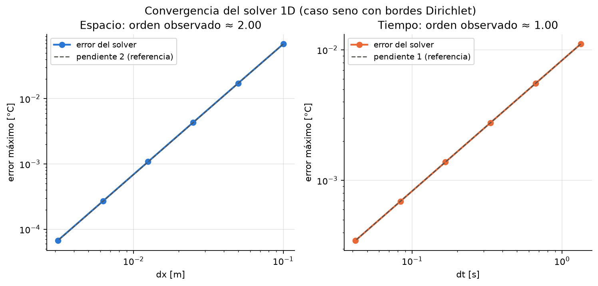
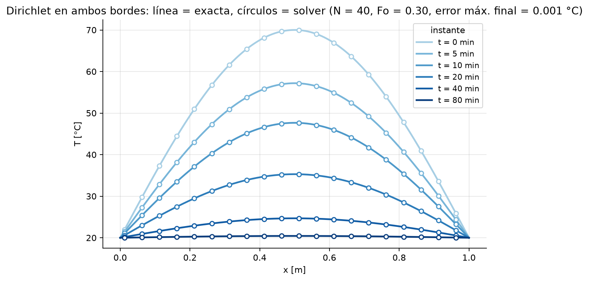

# Informe E03: verificación del solver 1D

> Entrega E03 · 23 de octubre de 2026 · Grupo 7 · Reproducir: `pytest -v` y
> `python scripts/04_convergencia_1d.py`

## 1. Objetivo

**Verificar** es comprobar que el programa resuelve bien su ecuación (si esa ecuación representa
al hormigón se *valida* después, con Ju y Lei 2019). Medimos el error contra una solución exacta
y comprobamos que, al refinar $\Delta x$ y $\Delta t$, baja como predice la teoría.

## 2. Problema de prueba

$$\frac{\partial T}{\partial t} = \alpha\frac{\partial^2 T}{\partial x^2},\quad T(0,t)=T(L,t)=T_b,\quad T(x,0)=T_b+A\sin\frac{\pi x}{L}$$

$$T(x,t) = T_b + A\,\sin\frac{\pi x}{L}\,e^{-\alpha(\pi/L)^2 t}$$

El modo seno cumple ambos bordes y decae a su propia tasa (separación de variables;
`analiticas.seno_dirichlet`). Datos: $L = 1$ m, $\alpha = 10^{-4}$ m²/s (material
didáctico, cálculo rápido), $T_b = 20$ °C, $A = 50$ °C; error medido en $t = 1500$ s (amplitud
restante 11,4 °C). Ejercita el borde Dirichlet, lo delicado en una malla de celdas: la
superficie queda a $\Delta x/2$ del centro.

## 3. Esquema

Volúmenes finitos centrados en celdas ([teoría, Parte C](1_teoria.md)): $N$ celdas de ancho
$\Delta x = L/N$, cada una con su balance *acumulación = entra − sale*. Flujo entre vecinas:
$G(T_i - T_{i+1})$, con $G = k/\Delta x$ ($2k/\Delta x$ hacia la superficie Dirichlet). Euler
explícito:

$$T_i^{n+1} = T_i^n + \frac{\Delta t}{C_i}\left(F_i^n - F_{i+1}^n\right)$$

Estable si $Fo = \alpha\Delta t/\Delta x^2 \le 1/2$ (interior) y $\le 1/3$ (junto a Dirichlet).
Error teórico (Taylor): $O(\Delta x^2)$ por la diferencia centrada y $O(\Delta t)$ por Euler.

## 4. Metodología

Error: $e = \max_i |T_i - T_{\text{exacta}}(x_i, t)|$ [°C]; orden observado:
$p = \ln(e_1/e_2)/\ln(h_1/h_2)$.

- **Espacio:** $N = 10 \to 320$ con $Fo = 0{,}25$ fijo (bajo 1/3). Como $\Delta t \propto \Delta x^2$,
  el error temporal también escala como $\Delta x^2$: al duplicar $N$ el error total debe caer
  4 veces.
- **Tiempo:** $N = 50$ fijo, $\Delta t = \Delta t_{max} = 1{,}333$ s hasta $\Delta t_{max}/32$.
  Contra la exacta, el error espacial (que no baja con $\Delta t$) taparía al temporal; por eso
  la referencia usa la **misma malla** y se obtiene por **extrapolación de Richardson**: si
  $T(\Delta t) \approx T^* + C\Delta t$, entonces $2T(h) - T(2h) \approx T^*$
  ($h = \Delta t_{max}/256$).

## 5. Resultados

| $N$ | $\Delta x$ [m] | error [°C] | $p_x$ | $\Delta t$ [s] | error [°C] | $p_t$ |
|---:|---:|---:|---:|---:|---:|---:|
| 10 | 0,1 | 6,865·10⁻² | — | 1,3333 | 1,108·10⁻² | — |
| 20 | 0,05 | 1,728·10⁻² | 1,990 | 0,6667 | 5,538·10⁻³ | 1,000 |
| 40 | 0,025 | 4,327·10⁻³ | 1,998 | 0,3333 | 2,769·10⁻³ | 1,000 |
| 80 | 0,0125 | 1,082·10⁻³ | 1,999 | 0,1667 | 1,384·10⁻³ | 1,000 |
| 160 | 0,00625 | 2,705·10⁻⁴ | 2,000 | 0,0833 | 6,922·10⁻⁴ | 1,000 |
| 320 | 0,003125 | 6,764·10⁻⁵ | 2,000 | 0,0417 | 3,461·10⁻⁴ | 1,000 |

Datos: [`resultados/convergencia_1d.csv`](../resultados/convergencia_1d.csv).

*Figura 1 — Error vs $\Delta x$ y vs $\Delta t$ (log-log), sobre rectas de pendiente 2 y 1.*

Órdenes observados: **2,00 en espacio y 1,00 en tiempo**, los teóricos. Con $N = 320$ el error
es 6,8·10⁻⁵ °C sobre 11,4 °C de amplitud. Costo: con $Fo$ fijo, dividir $\Delta x$ por 2
multiplica el cálculo 1D por 8 (2× celdas, 4× pasos) y divide el error por 4.

*Figura 2 — Exacta (líneas) vs solver (círculos), $N = 40$, $Fo = 0{,}30$ (paso por defecto, 90 %
del máximo); error final ≈ 0,001 °C.*

## 6. Tests complementarios

`pytest`: **23/23 tests pasan** (15 del solver), cada uno contra algo que sabemos cierto:

| Test | Qué verifica | Criterio |
|---|---|---|
| Conservación de energía | Adiabático sin fuente: $\sum C_i T_i$ constante (lo que sale de una celda entra a la vecina) | rel. < 10⁻¹² |
| Balance Neumann + fuente | $E(t) - E(0) = (q + QL)\,t$ (hormigón, 5 días) | rel. 10⁻¹⁰ |
| Fuente uniforme adiabática | $T = T_0 + Qt/\rho c_p$ | rel. 10⁻¹² |
| Estacionarios Robin | Tiende a $T_\infty$; perfil lineal con aire + moldaje en serie | 10⁻⁶ °C |
| Dos materiales | Perfil por tramos exacto (media armónica de $k$) | 10⁻⁶ °C |
| Estabilidad | $\Delta t_{max}$ da $Fo = 1/2$ y $1/3$ (Dirichlet); un $\Delta t$ mayor se rechaza | estable: $T \in [20, 60]$ °C; $Fo = 0{,}6$: $\lvert T\rvert > 10^6$ |

En régimen permanente no hay error temporal y un perfil lineal por tramos no tiene error de
truncamiento: por eso la tolerancia es tan estricta.

## 7. Limitaciones

- Con $Fo$ fijo se mide el error **total**: según la ecuación modificada, el término dominante
  es $\propto (1 - 6Fo)\,\Delta x^2$ (1 espacial, $-6Fo$ temporal), que a $Fo = 0{,}25$ se
  compensan parcialmente. Confirma orden 2 del método, sin aislar la parte espacial.
- Un solo modo, Dirichlet, propiedades constantes, sin fuente. Robin, Neumann, interfaces y
  $Q(t,x)$ se verifican con estacionarios o balances, sin estudio de convergencia.
- Norma máxima en un instante; falta la sensibilidad de las métricas del proyecto ($T_{max}$,
  diferencial núcleo–$S_{25}$).
- Verificar no es validar: falta calibrar propiedades y comparar con Ju y Lei (2019).
- Solo 1D: el 2D/3D (semana 2) requiere nueva verificación ($Fo \le 1/4$ y $1/6$).

## 8. Conclusión

El solver reproduce la solución exacta, converge con los órdenes teóricos, conserva la energía y
respeta su límite de estabilidad: es una base verificada para el 2D/3D.
