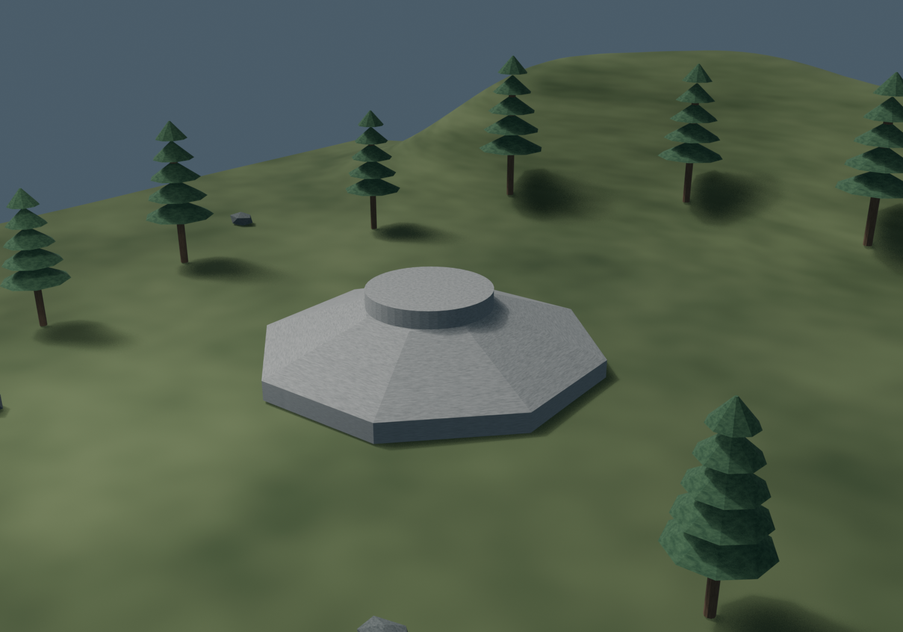
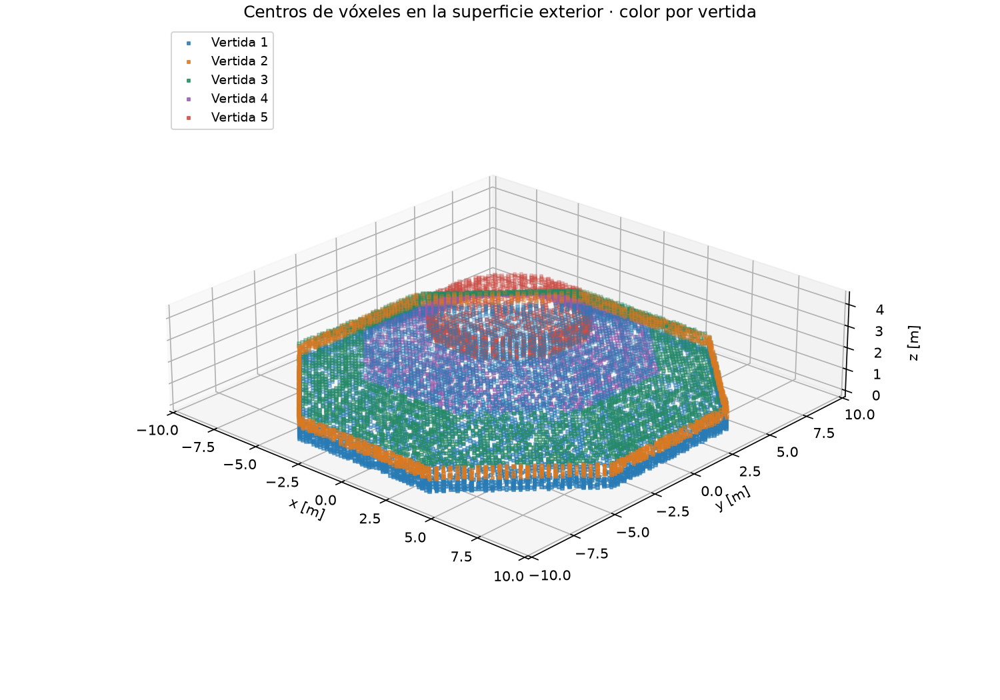
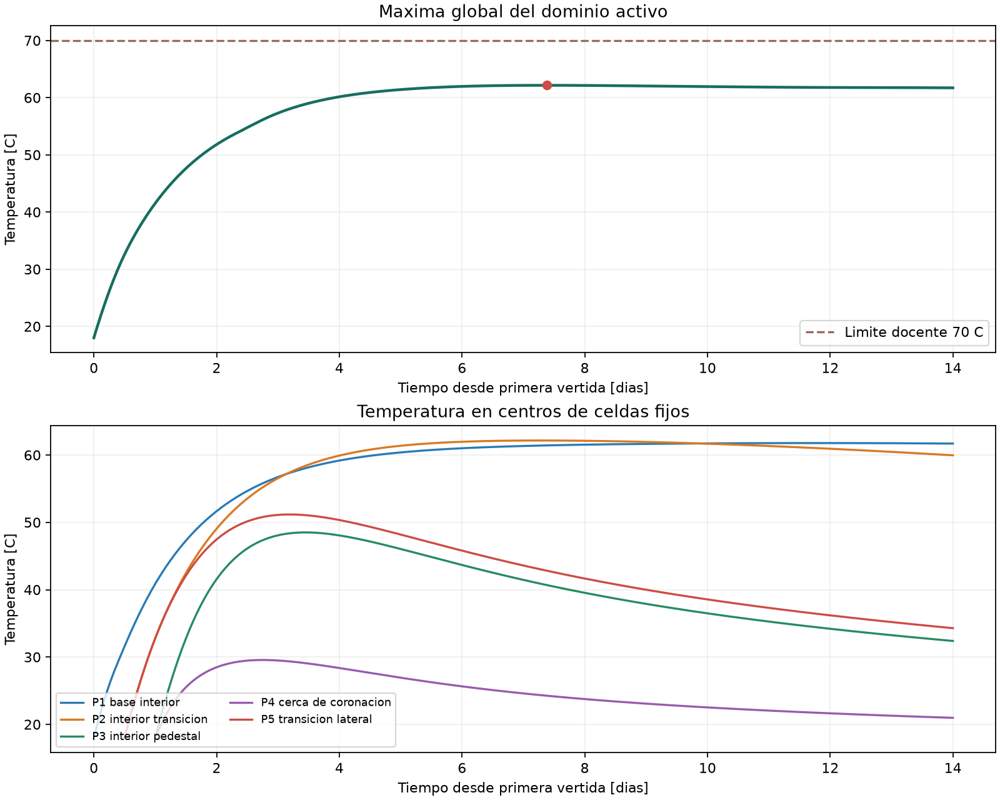
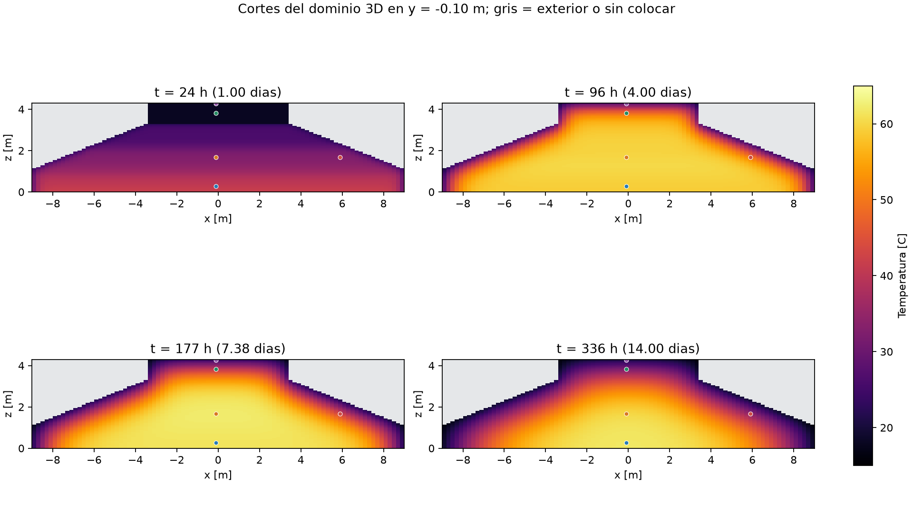
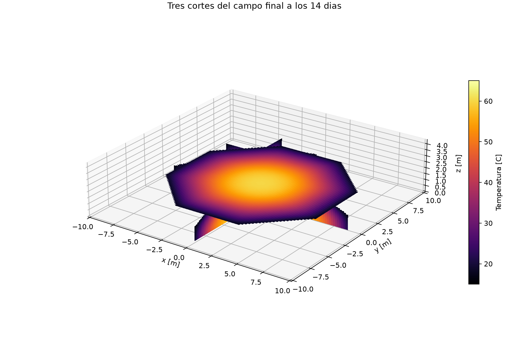

# E09 — Baseline 3D con hidratación

Grupo 7 · Renaico, La Araucanía · Parque Eólico Vergara.

Repositorio: <https://github.com/aespinoza6-svg/P2-Grupo7>. **Commit evaluado** identificado por la etiqueta fija [E09](https://github.com/aespinoza6-svg/P2-Grupo7/tree/E09). Su SHA se obtiene con `git rev-parse E09^{commit}` y se declara en Canvas. El baseline se calculó sobre [`cc9ff9f`](https://github.com/aespinoza6-svg/P2-Grupo7/commit/cc9ff9f8b1ead06c3133f0b5d27764d5b9e71cb5); la entrega incorpora los avances posteriores del grupo.

## Geometría, discretización y vertidas

Adoptamos la geometría docente del curso, con planta octagonal de 18 m entre caras, espesor de borde de 1,10 m, transición hasta 3,30 m y pedestal de diámetro 7 m y altura 1 m. La imagen BIM muestra el contexto ilustrativo del caso. La geometría efectiva se extrae de los cinco sólidos IFC, conservando sus identidades, horarios y temperaturas.



El voxelizador clasifica el centro de cada celda contra la superficie triangulada cerrada. Una celda interior recibe `vertida_id`; 0 representa exterior. La malla mide 0,20 × 0,20 × 0,05 m y contiene 317 972 celdas de hormigón. El volumen IFC es 636,775 m³ y el voxelizado 635,944 m³, una diferencia de −0,831 m³ y **−0,131 %**. La frontera escalonada aproxima además el área expuesta y requiere estudiar precisión térmica espacial.



| Vertida | Cotas z [m] | Inicio [h] | Volumen IFC [m³] | T colocación [°C] |
|---|---|---:|---:|---:|
| V01 | 0–0,55 | 0 | 147,626 | 18 |
| V02 | 0,55–1,10 | 6 | 147,626 | 18 |
| V03 | 1,10–2,20 | 12 | 214,224 | 18 |
| V04 | 2,20–3,30 | 18 | 88,925 | 18 |
| V05 | 3,30–4,30 | 24 | 38,375 | 18 |

Cada vertida aparece instantáneamente a su horario, inicia su reloj de hidratación y recibe su temperatura de colocación. Las temperaturas anteriores se conservan. Antes de colocarse, sus celdas carecen de capacidad e intercambio térmico. Al cubrir una superficie expuesta se establece conducción con contacto perfecto. La secuencia procede del IFC.

## Física y ambiente simplificado

Resolvemos $\rho c_p\partial T/\partial t=\nabla\cdot(k\nabla T)+\dot q_h$ mediante volúmenes finitos y Euler explícito. Usamos $k=2$ W/(m·K), $\rho=2400$ kg/m³ y $c_p=900$ J/(kg·K). El paso máximo es 600 s, limitado por $\Delta t\leq0,8\min(C_i/S_i)$, con pasos cortados en las colocaciones. El horizonte es 336 h y las salidas son horarias.

Para edad $a=t-t_{inicio}$, la elevación adiabática es $\theta_{ad}=45(1-e^{-a/\tau})$ °C, con $\tau=30$ h. Su derivada proporciona

$$\dot q_h=\rho c_p\frac{45}{\tau}e^{-a/\tau}\quad[\mathrm{W/m^3}].$$

Con $\tau=108000$ s, la fuente inicial es 900 W/m³. Se integra su energía exactamente en cada paso. Los parámetros proceden del ejemplo pedagógico de la guía del curso y están pendientes de calibración. La fuente decae desde la colocación, sin inducción ni dependencia de la temperatura.

En caras expuestas laterales y superiores usamos Robin con aire constante a 15 °C y $h=10$ W/(m²·K). Las caras expuestas de orientación z− son adiabáticas. Son simplificaciones declaradas, pendientes de clima real, suelo, moldajes y retiro de protecciones.

## Resultados y puntos de observación

La máxima global es **62,164 °C a las 177,167 h, día 7,382**. Se observa calentamiento por hidratación, acumulación interior y enfriamiento lento posterior. El balance incluye energía incorporada con material nuevo, hidratación e intercambio exterior. Su residuo relativo máximo es $1,50\times10^{-15}$.

Las historias se extraen de centros fijos del corte y≈−0,10 m. Las curvas comienzan al activarse su vertida. P4 está a 25 mm de la coronación horizontal del pedestal; los puntos seleccionados describen el campo y requieren un protocolo específico para evaluar el diferencial normativo.

El origen está en el centro de la planta y z=0 en la base. Todos los puntos tienen y≈−0,10 m. Los picos de la tabla se buscan entre salidas horarias.

| Punto | x [m] | z [m] | Vertida | Máxima [°C] | Hora [h] |
|---|---:|---:|---|---:|---:|
| P1 base interior | −0,10 | 0,275 | V01 | 61,777 | 284 |
| P2 interior transición | −0,10 | 1,675 | V03 | 62,158 | 175 |
| P3 interior pedestal | −0,10 | 3,825 | V05 | 48,505 | 83 |
| P4 cerca de coronación | −0,10 | 4,275 | V05 | 29,561 | 66 |
| P5 transición lateral | 5,90 | 1,675 | V03 | 51,172 | 77 |







La máxima queda bajo 70 °C, pero el par fijo P2–P4 alcanza **39,308 °C a las 275 h**, comparando temperaturas simultáneas. Supera los 20 °C docentes para ese par y evidencia la necesidad de control térmico. La evaluación completa requiere definir otros pares representativos y comprobar sensibilidad espacial, especialmente cerca de superficies inclinadas. Este baseline tampoco incorpora calibración experimental.

## Comparación cualitativa con Ju y Lei

Ju y Lei registraron acumulación y liberación de calor, un pico interior cercano a 73 °C al día 4 y una diferencia núcleo–superficie de unos 35 °C al día 9. Nuestra simulación reproduce calentamiento inicial, interior más caliente y enfriamiento superficial e interior a velocidades diferentes. El pico aparece más tarde y es menor. Estas semejanzas describen mecanismos térmicos, mientras las diferencias reflejan hidratación, ambiente, geometría y secuencia distintos. [Ju y Lei, 2019](https://doi.org/10.1155/2019/7029671).

**¿Qué reproduce y qué falta?** Reproducimos las dos etapas térmicas y la heterogeneidad espacial. Aún faltan la cinética calibrada por ensayo adiabático y edad equivalente, clima y suelo del experimento, sensores equivalentes y evaluación termomecánica del agrietamiento. El experimento inicial se colocó en capas continuas durante 24 h, y el programa docente usa cinco vertidas instantáneas. La discretización y las condiciones simplificadas también afectan el enfriamiento. No se ajustaron parámetros para alcanzar 73 °C. [Ju y Lei, 2019](https://doi.org/10.1155/2019/7029671).

## Reproducibilidad

Desde la raíz del repositorio, después de instalar `requirements.txt`:

```powershell
.\.venv\Scripts\python.exe -X utf8 scripts/12_baseline_e09.py
```

El script conserva copias de IFC y configuraciones en `resultados/e09/entradas/`, ejecuta los solvers existentes y produce CSV, NPZ, figuras y `evidencia.json` con huellas SHA-256. `--solo-figuras` repite el procesamiento de resultados. Los datos numéricos completos quedan junto a las imágenes. La imagen BIM y la voxelización permiten contrastar la representación geométrica.
